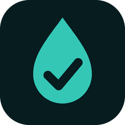

<div align="center">



# Safe Screen Logistics

**Testing, blood draws and IV therapy that come to you.**

[gosafescreen.com](https://gosafescreen.com)


<br />


</div>

<br />

The marketing and booking site for Safe Screen Logistics, a mobile clinical service. A licensed
clinician comes to a home or workplace for DOT and non-DOT testing, annual and insurance blood
draws, and IV hydration therapy.

## Contents

- [What the site does](#what-the-site-does)
- [Pages](#pages)
- [Design](#design)
- [Quick start](#quick-start)
- [Editing content](#editing-content)
- [Project structure](#project-structure)
- [What is mocked](#what-is-mocked)
- [Before launch](#before-launch)
- [Deploying](#deploying)

## What the site does

| Service | What is offered | Page |
| --- | --- | --- |
| **DOT and Non-DOT Testing** | Drug and alcohol testing for regulated drivers and for employers with their own policy, collected on site | `/services/drug-testing` |
| **Mobile Blood Draws** | Annual blood draws and insurance blood draws, collected wherever the client is | `/services/blood-draws` |
| **IV Hydration Therapy** | Eleven drip formulas: ten at $250 and the flagship Full Body Restart at $500 | `/services/iv-therapy`, `/menu` |

Every service can be booked through a five-step wizard at `/book`, by phone at **765-372-6440**,
or by email at **safescreenlogistics@gmail.com**.

## Pages

| Route | Purpose |
| --- | --- |
| `/` | Home: the specimen rack hero, service rows, drip menu teaser, three-step process |
| `/services` | One band per service with price, visit length, options and a booking button |
| `/services/[slug]` | Service detail: what you get, what to expect, who it is for (statically generated) |
| `/menu` | The IV drip menu, laid out as a menu with dotted leaders and prices |
| `/book` | Booking wizard: service, location, time, details, confirm |
| `/learn`, `/learn/[slug]` | Plain-language articles and FAQs (statically generated) |
| `/about` | What the business does and how it works |
| `/contact` | Phone, email, hours and a contact form |
| `/sitemap.xml`, `/robots.txt` | Generated from the service and article data |
| `/opengraph-image` | The link preview card shown above, generated by the site |

## Design

The look comes from the collection kit itself.

- **Hero.** A specimen cup, two capped blood tubes and an IV bag stand on a shelf and fill in
  sequence when the page loads. Each one links to the service it stands for. It is built in SVG
  and CSS, with no JavaScript.
- **Color.** Deep petrol and a cool label-white, with accents taken from tube caps and the
  liquids: lavender, gold, crimson, amber and mint.
- **Type.** Bricolage Grotesque for headings and Instrument Sans for body text.
- **Layout.** Hairline-divided rows instead of card grids. The drip menu reads like a menu.
- **Motion.** Two animated pieces only: the hero fill and a scroll-driven drip vessel on the
  home page. Both respect `prefers-reduced-motion`.
- **Icon.** A mint droplet with a check mark, used for the favicon, the Apple touch icon and
  the header logo.

Design tokens live in [`src/app/globals.css`](src/app/globals.css).

## Quick start

Requires Node.js 20.9 or newer.

```bash
npm install
npm run dev
```

Open http://localhost:3000.

| Command | What it does |
| --- | --- |
| `npm run dev` | Start the development server |
| `npm run build` | Create a production build |
| `npm run start` | Serve the production build |
| `npm run lint` | Run ESLint |

## Editing content

All copy, pricing and contact details live in `src/data`. Pages read from these files, so a
change here updates every place the content appears.

| To change | Edit |
| --- | --- |
| Phone, email, domain, hours, navigation, social links | [`src/data/site.ts`](src/data/site.ts) |
| Services, their options, steps and pricing | [`src/data/services.ts`](src/data/services.ts) |
| IV drip menu and prices | [`src/data/drips.ts`](src/data/drips.ts) |
| FAQs | [`src/data/faqs.ts`](src/data/faqs.ts) |
| Articles | [`src/data/articles.ts`](src/data/articles.ts) |
| Client testimonials | [`src/data/testimonials.ts`](src/data/testimonials.ts) |

Two lists are empty on purpose and their sections stay hidden until they have real entries:

- **Testimonials.** Add real client quotes to `testimonials.ts` and the home page section appears.
- **Social links.** Add real account URLs to `site.social` and the footer row appears.

## Project structure

```
src/
  app/                 Routes, layout, global styles, icons, sitemap, robots
    api/               Mocked POST handlers: book, contact, newsletter
    opengraph-image.tsx  Generated link preview card
  components/          Header, footer, booking wizard, forms, hero rack
    ui/                Button, container, section heading
    fluid/             Scroll-driven drip vessel
  data/                All site content (see the table above)
  lib/                 Class-name helper
docs/readme/           Images used in this README
```

For a deeper map, see [`CODE_MAP.md`](CODE_MAP.md), [`ENTRY_POINTS.md`](ENTRY_POINTS.md),
[`DATA_FLOW.md`](DATA_FLOW.md), [`IMPORT_GRAPH_SUMMARY.md`](IMPORT_GRAPH_SUMMARY.md) and
[`FEATURE_BOUNDARIES.md`](FEATURE_BOUNDARIES.md).

## What is mocked

The three forms validate input with zod and return a realistic response, but nothing is stored
or sent yet. Each handler marks where a real service plugs in.

| Form | Handler | Still to connect |
| --- | --- | --- |
| Booking wizard | `src/app/api/book/route.ts` | Scheduling, payments, confirmation email |
| Contact form | `src/app/api/contact/route.ts` | Email delivery or a CRM |
| Newsletter signup | `src/app/api/newsletter/route.ts` | A mailing list provider |

Until these are connected, a booking or message submitted on the site does not reach anyone.

## Before launch

Content that still needs confirming with the client:

- [ ] Business hours in `site.ts`
- [ ] The service area line on the contact page
- [ ] The three partner locations offered in the booking wizard
- [ ] The DOT and non-DOT testing wording, visit length and pricing in `services.ts`
- [ ] Drip descriptions in `drips.ts`, which are written placeholders
- [ ] Real testimonials and social links, if wanted

## Deploying

The site runs on Vercel with no extra configuration. With Vercel's Git integration connected,
pushing to `main` deploys to production.

The domain is set once in `src/data/site.ts` (`domain` and `url`). The sitemap, robots file,
page metadata and link preview card all read from it.

The link preview card fetches its heading font from Google Fonts at build time. If that request
fails, the card still renders with a built-in font and the build does not break.

After a deploy, messaging apps may keep showing an older link preview for a while because they
cache it.
